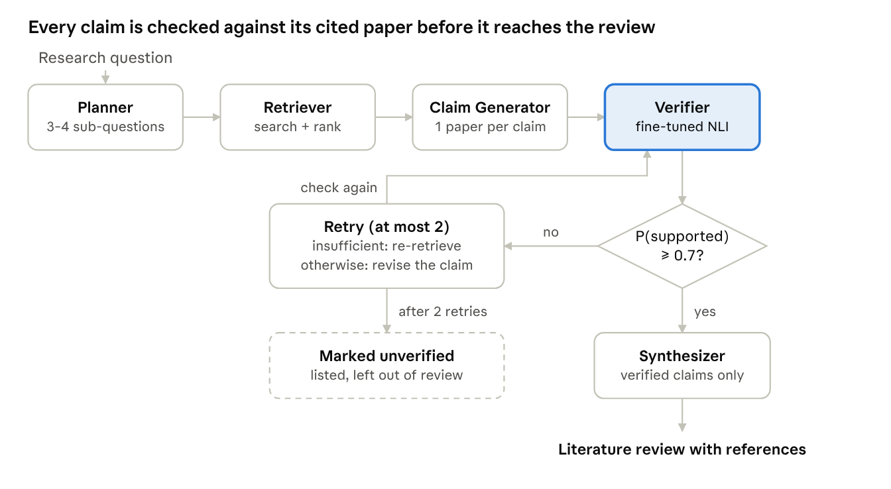
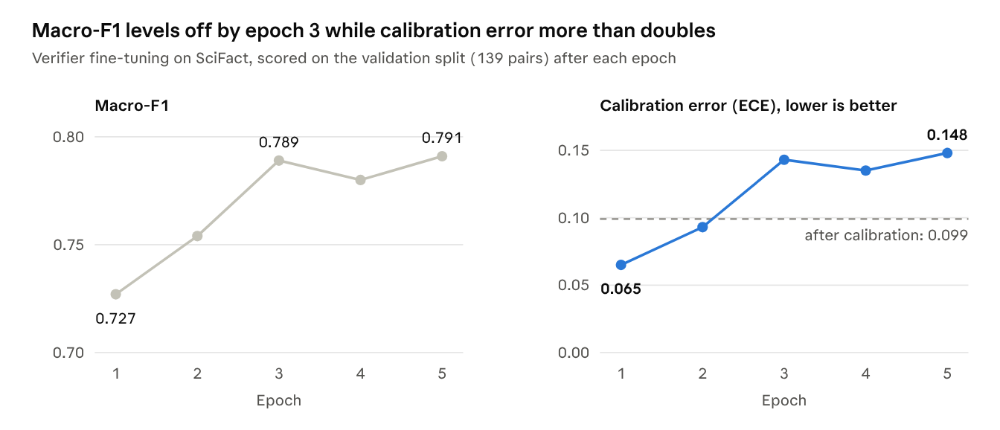
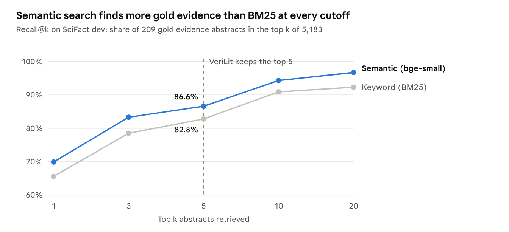

# VeriLit: Self-Verifying Multi-Agent Research Assistant

Project report · Maryam Asif (23k-0505), Nimra Ashraf (23k-0867) · Nov 28, 2026

## Abstract

LLM research assistants often state claims their cited papers do not support. VeriLit is a five-agent research assistant that checks every generated claim against the abstract of the paper it cites before the claim reaches the literature review. A Planner splits the question into sub-questions, a Retriever finds papers on Semantic Scholar and arXiv, a Claim Generator writes atomic claims with one citation each, a Verifier labels each claim Supported, Contradicted or Insufficient Evidence with a calibrated confidence, and a Synthesizer writes the review from verified claims only. Unsupported claims go through a feedback loop of re-retrieval or revision, up to two retries.

The Verifier is a DeBERTa-v3-small NLI model fine-tuned on SciFact. On the SciFact dev split it raises macro-F1 from 0.431 (off the shelf) to 0.738, and temperature scaling lowers its expected calibration error from 0.161 to 0.062. For retrieval, semantic search finds 86.6% of gold evidence abstracts in the top 5, against 82.8% for BM25. The full system is compared with a no-verification baseline on 25 research questions across AI, ML, NLP and cybersecurity, with 195 claims labeled by two annotators (Cohen's kappa 1.0 on 30 shared items). The generated claims were already faithful (97.4% supported), and verification did not reduce unsupported claims: VeriLit presented 4.3% unsupported against the baseline's 2.6%. The Verifier accepted all 5 unsupported claims, and its 9 false rejections sent supported claims into a feedback loop that moved 3 of them to papers that do not support them. We report this negative result and what it implies for verification stages.

## 1. Introduction

A literature review is only as reliable as its citations. LLM-based research assistants can retrieve and summarize papers quickly, but they also produce fluent claims that the cited paper does not state: a wrong number, an overgeneralized result, or a finding attributed to the wrong study. A reader cannot tell these apart from correct claims without opening every source.

VeriLit adds a verification stage between generation and the final review. Each factual claim is a single checkable statement that cites exactly one paper, and a fine-tuned natural language inference (NLI) model checks it against that paper's abstract. Claims that fail are re-retrieved or revised; claims that still fail are shown as unverified and kept out of the review. VeriLit tests whether a claim faithfully reflects its source, not whether the published paper itself is correct.

Our contributions:

- A five-agent pipeline (Planner, Retriever, Claim Generator, Verifier, Synthesizer) with a verification feedback loop, running entirely on free-tier services.
- A Verifier fine-tuned on SciFact with calibrated confidence scores, which decide when a claim is accepted, retried or marked unverified.
- An evaluation of the Verifier and the retriever on SciFact, and of the full system against a no-verification baseline on a hand-labeled test set of 25 research questions.
- A public, reproducible implementation: [github.com/maryamasifaziz/verilit](https://github.com/maryamasifaziz/verilit).

## 2. Related work

**Retrieval-augmented generation.** RAG grounds a language model's output in retrieved documents [1]. It reduces but does not remove unsupported statements: the model can still misread, merge or overstate what it retrieved. Work on generating text with citations measures exactly this gap between a statement and the source it cites [2].

**Scientific claim verification.** FEVER framed fact verification as labeling a claim Supported, Refuted or Not Enough Info against retrieved evidence [3]. SciFact applied the same framing to scientific claims checked against paper abstracts [4]; VeriLit uses SciFact to train and evaluate its Verifier.

**Hallucination detection and factuality.** SelfCheckGPT detects hallucinations from inconsistency across sampled outputs [5], and FActScore scores long-form text by splitting it into atomic facts and checking each against a knowledge source [6]. VeriLit follows the atomic-claim idea but checks each claim against the one paper it cites, so a failure points to a specific claim and source.

**Models and calibration.** The Verifier fine-tunes a DeBERTa-v3 NLI model [7], calibrates it with temperature scaling [8], and the retriever ranks papers with BGE embeddings [9].

## 3. System design

VeriLit runs five agents in order, with a feedback loop between the Verifier and the Retriever and Claim Generator (Figure 1).

*Figure 1 · VeriLit workflow: 5 agents, a retry loop of at most 2.* A claim reaches the review only if the Verifier accepts it; otherwise it is re-retrieved or revised and checked again, and after two failed retries it is listed as unverified.

- **Planner** (LLM). Splits the question into 3 to 4 sub-questions, for example methods, reported results, benchmarks and limitations, each with a short keyword search query.
- **Retriever.** Searches Semantic Scholar (20 results) and arXiv (10 results) with the query, removes duplicates and papers without an abstract, and ranks the rest against the sub-question by cosine similarity of BGE embeddings (bge-small-en-v1.5). The top 5 papers go to the Claim Generator.
- **Claim Generator** (LLM). Writes up to 3 claims per sub-question (2 in the evaluation). Each claim is one self-contained, checkable statement that cites exactly one of the retrieved papers and is stated in its abstract.
- **Verifier.** The fine-tuned NLI model (Section 5) scores the claim (hypothesis) against the cited paper's title and abstract (premise). A claim is accepted when its calibrated probability of Supported is at least 0.7.
- **Synthesizer** (LLM). Writes a 250 to 400 word review from the accepted claims only and names the sub-questions left without evidence.

**Feedback loop.** A claim that is not accepted is retried up to 2 times. If the cited abstract gives insufficient evidence, the Retriever searches with the claim itself and the Verifier checks it against the top 3 new papers; VeriLit switches to a new paper only if it supports the claim better. Otherwise, or if re-retrieval did not help, the Claim Generator rewrites the claim to state only what the abstract says. A claim still not accepted after the limit is listed as unverified and left out of the review.

**Design choices.**

- Reference numbers are assigned by code, not by the LLM, and the report flags any citation in the review that has no matching reference. The LLM therefore cannot invent a citation.
- Claims are checked against abstracts, because both search APIs return abstracts and SciFact evidence is abstract-level, so the Verifier sees the same kind of text in training and in use.
- All services are free tier. The LLM is Gemini 3.5 Flash-Lite through its OpenAI-compatible API (a Groq preset is the fallback). Requests are spaced to stay under per-minute limits, retried with exponential backoff, and every LLM reply and search result is cached on disk, so a re-run costs no quota and is reproducible. One question takes about 5 to 8 LLM requests and 30 to 120 seconds.
- A no-verification baseline runs the same Planner, Retriever and Claim Generator and synthesizes from all claims, so the two systems differ only in the verification stage.

## 4. Data

**SciFact.** SciFact [4] pairs scientific claims with the abstracts they cite: 809 training claims, 300 dev claims and 300 test claims, over a corpus of 5,183 abstracts. Test labels are not public, so the dev split serves as our final test set. We turn each (claim, cited abstract) into one pair, with the premise being the paper's title plus full abstract:

- SUPPORT rationales → **Supported** (NLI entailment)
- CONTRADICT rationales → **Contradicted** (contradiction)
- cited but no rationale → **Insufficient Evidence** (neutral)

We hold out 15% of the training claims as a validation set, split by claim so that no claim appears in both, and keep dev untouched until final results.

| Split | Claims | Pairs | Supported | Contradicted | Insufficient |
| --- | ---: | ---: | ---: | ---: | ---: |
| Train | 688 | 780 | 323 | 167 | 290 |
| Validation | 121 | 139 | 47 | 27 | 65 |
| Dev (test) | 300 | 340 | 138 | 71 | 131 |

SciFact is biomedical. It validates the Verifier's claim checking but not its transfer to AI, ML, NLP and cybersecurity papers; the custom test set covers that gap.

**Custom test set.** 25 research questions: 9 in NLP, 6 in ML, 6 in cybersecurity and 4 in general AI (Appendix A). VeriLit runs on each with 2 claims per sub-question. Every original claim is labeled by hand, and these are also the baseline's claims; claims the feedback loop changed and then verified are labeled again in their final form. Each row of the labeling sheet shows a claim and its cited abstract, shuffled across questions and without the Verifier's verdict. The two authors label separately, with 30 rows shared to measure agreement, following a written guide (Appendix B).

**Literature sources.** Semantic Scholar and arXiv are search sources at run time, not training data.

## 5. Verifier training and evaluation

Fine-tuning raises the Verifier's macro-F1 on SciFact dev from 0.431 to 0.738, and calibration cuts its expected calibration error (ECE) from 0.161 to 0.062 without changing any prediction.

| Verifier (SciFact dev, 340 pairs) | Accuracy | Macro-F1 | ECE |
| --- | ---: | ---: | ---: |
| Off-the-shelf NLI (baseline) | 0.482 | 0.431 | 0.458 |
| Fine-tuned | 0.756 | 0.738 | 0.161 |
| Fine-tuned + calibrated (T = 1.908) | 0.756 | 0.738 | **0.062** |
| Fine-tuned + calibrated, best passage (T = 2.223) | 0.741 | 0.728 | 0.086 |

**Baseline.** The off-the-shelf model is cross-encoder/nli-deberta-v3-small, trained on general NLI data. Given a full abstract as premise, it labels most claims Insufficient: it calls 113 of the 138 Supported pairs Insufficient, so Supported recall is 0.130.

**Fine-tuning.** We fine-tune the same model on the 780 training pairs, keeping its pretrained 3-way head (entailment, contradiction and neutral map directly to our three labels). Settings: AdamW, learning rate 2e-5, weight decay 0.01, effective batch 16, 5 epochs with 10% linear warmup, maximum length 512 tokens (the abstract is truncated, never the claim), seed 42. After each epoch we score the validation set and keep the epoch with the best macro-F1, which was epoch 5 (validation macro-F1 0.791). Training took about 11 minutes per epoch on a 4-core CPU.

*Figure 2 · results/finetuned_dev/training_log.json and results/calibration_val.json, first training run.* The model keeps getting more confident after its accuracy stops improving, which is why the calibration step follows training.

**Calibration.** We fit a single temperature T on the validation set by minimizing negative log-likelihood (temperature scaling [8]). T = 1.908 means the fine-tuned model was over-confident; dividing its logits by T lowers validation ECE from 0.148 to 0.099 and dev ECE from 0.161 to 0.062. The calibrated probability of Supported is VeriLit's confidence score. We accept a claim at P(Supported) ≥ 0.7: on validation, 84% of the pairs accepted at that threshold are truly Supported, and 57% of Supported pairs are accepted. Failed claims are retried, so we favour precision over recall.

**Full abstract or best passage.** On a long abstract the evidence for a claim can be one sentence among many. We tested an alternative that scores the claim against every window of 3 consecutive sentences (plus the full abstract) and keeps the window with the lowest Insufficient probability. We chose between the two on validation before looking at dev: macro-F1 0.791 for the full abstract against 0.781 for passages, so the full abstract is the default, and dev agrees (table above). Passages find more Supported claims (recall 0.812 against 0.768 on dev) but also accept more that are not. VeriLit records both scores for every claim, so Section 7 compares them on AI-domain papers too.

**Reproducibility.** A second training run with the same code on a Colab T4 GPU (about 50 seconds per epoch) reached dev accuracy 0.744, macro-F1 0.721 and calibrated ECE 0.067 (T = 1.983), again with epoch 5 best. Two runs therefore differ by about 0.02 macro-F1. All other results in this report use the first run's model.

## 6. Retrieval evaluation

Semantic search finds more of the gold evidence than keyword search at every cutoff: 86.6% of gold abstracts in the top 5, against 82.8% for BM25.

We search all 5,183 SciFact abstracts with each dev claim that has evidence (188 claims, 209 gold abstracts) as the query. Recall@k is the share of gold evidence abstracts that appear in the top k, that is, whether the retrieved text contains the evidence needed to verify the claim. The semantic ranker embeds title plus abstract with bge-small-en-v1.5 [9] and ranks by cosine similarity; the baseline is Okapi BM25 over lowercased words without stop words.

*Figure 3 · results/retrieval_dev.json, 188 SciFact dev claims with evidence.*

This is a harder test than VeriLit's real use: in the pipeline the ranker chooses 5 papers from a few dozen candidates that the search APIs already matched to the query. Embedding the 5,183 abstracts took about 6 minutes on CPU; BM25 took 3 seconds.

## 7. Full-system evaluation

**Setup.** VeriLit and the no-verification baseline share the same LLM, papers and generated claims; the baseline presents every original claim, while VeriLit presents only the claims it verified, in their final form. Each of the 25 questions produced 6 to 8 claims (190 in total). Two annotators labeled each claim against the abstract of its cited paper (Supported, Contradicted or Insufficient), plus the final form of the 5 claims the feedback loop changed, so 195 items; 30 items were labeled by both. Results are in `results/custom_eval.json`.

| Metric | Definition | VeriLit | Baseline |
| --- | --- | ---: | ---: |
| Claims presented | | 186 | 190 |
| Unsupported-claim rate | Share of presented claims labeled Contradicted or Insufficient | 4.3% (8) | 2.6% (5) |
| Contradicted rate | Share of presented claims labeled Contradicted | 0.5% (1) | 0.5% (1) |
| Citation correctness | Share of citations whose paper supports the claim (each claim cites one paper, so 1 − unsupported rate) | 95.7% | 97.4% |
| Evidence coverage | Share of the 96 sub-questions with at least one presented claim labeled Supported, so dropping claims cannot score well | 99.0% | 100% |

**The main result is negative.** The generated claims were already faithful: 185 of the 190 original claims (97.4%) are Supported by their cited abstract. Verification did not lower the unsupported-claim rate; VeriLit presented 8 unsupported claims against the baseline's 5. The counts are small (a difference of 3 claims), so the honest reading is that verification made no measurable improvement on this test set, rather than that it made things worse. The reasons are in the two tables below.

**The Verifier on AI-domain papers.** Agreement with the hand labels on the 190 original claims (threshold 0.7):

| Evidence | Precision (accepted → labeled Supported) | Recall (labeled Supported → accepted) | F1 | Unsupported claims caught |
| --- | ---: | ---: | ---: | ---: |
| Full abstract (used) | 0.972 | 0.951 | 0.962 | 0 of 5 |
| Best passage | 0.973 | 0.984 | 0.978 | 0 of 5 |

The Verifier made two kinds of error:

- **It missed every unsupported claim.** All 5 were accepted with P(Supported) between 0.88 and 0.95. They are subtle: each claim is close to its abstract and differs in one detail, such as dropping a condition ("when the conditional probability is Gaussian"), attributing a result to the wrong variant, naming a dataset the abstract does not name, or (the one Contradicted claim) calling a taxonomy of ante-hoc methods post-hoc. A sentence-pair NLI model trained on SciFact does not separate these from paraphrases.
- **It rejected 9 Supported claims.** All 9 claims that entered the feedback loop were already supported by their first paper. Most were stated in long abstracts; one claim describing the SAFE factuality evaluator, taken almost word for word from its paper's abstract, scored 0.10. Passage scoring would have accepted 7 of these 9 (Section 5 found the same trade-off on SciFact).

**Feedback loop.** 9 claims were retried (0.6 retries per question). 5 ended verified (55.6%), but the hand labels confirm only 2 of those 5 (40%):

- **Revision worked twice.** For example, "Another study evaluates image classification performance using four benchmark datasets: MNIST, FashionMNIST, CIFAR10, and CIFAR100" scored 0.56; the revised claim names the method ("The SNNL-augmented Mixture-of-Experts approach is evaluated across four benchmark image classification datasets…") and scored 0.93, and both annotators agree it is Supported.
- **Re-retrieval moved 3 claims to worse papers.** Each claim kept its text but was re-cited to a new paper that the Verifier scored highly (0.86 to 0.96) and the annotators did not. For example, "Chain-of-thought prompting … encourages a large language model to think step by step to improve performance on reasoning tasks" was moved from a paper on chain-of-thought prompting (0.49) to one on chain-of-thought optimization for ranking (0.94); the new abstract does not say chain-of-thought improves reasoning performance. These 3 claims account for VeriLit's extra unsupported claims.
- **4 Supported claims were dropped** after two failed retries, which removed one sub-question's only supported claim (coverage 99.0%).

**Annotator agreement.** The annotators agreed on all 30 shared items (raw agreement 1.000, Cohen's kappa 1.000), so no disagreements needed settling. Because 29 of the 30 were labeled Supported by both, this is weak evidence of agreement on the rare Insufficient and Contradicted labels; the shared sample contained only one such item.

**What this means.** With a generator constrained to abstract-stated claims, unsupported claims are rare (2.6%) and subtle, and the fine-tuned Verifier is not precise enough to catch them: its errors fall on supported claims (false rejections), which the feedback loop then sometimes "repairs" into unsupported ones. Verification would need a much more precise Verifier to pay off here; Sections 8 and 10 discuss how.

## 8. Discussion and limitations

The Verifier is the component VeriLit depends on most, and its main risk is domain shift: it is trained on biomedical claims and applied to AI, ML, NLP and cybersecurity papers. An early example shows the failure mode. A claim stated word for word in a long AI abstract ("applying DPO to a Qwen2.5-0.5B generator reduces its hallucination rate from 85.5% to 37.7%") scored P(Supported) = 0.36 against the full abstract, below the threshold, but 0.89 against its best 3-sentence passage. On SciFact, passage scoring did not help overall (Section 5), but on the AI test set it would have avoided 7 of the 9 false rejections with no loss of precision (Section 7). Domain shift shows up in a second way too: the unsupported claims on AI papers are near-paraphrases that differ in one detail, which the Verifier accepted with high confidence.

Limitations:

- **Verifier precision.** The Verifier caught none of the 5 unsupported claims, so on this test set verification acted as a filter on good claims rather than bad ones. A claim-level check that compares specific details (numbers, conditions, names) would be needed.
- **Re-retrieval trusts the Verifier.** The feedback loop moves a claim to whichever paper scores highest, so a Verifier error becomes a wrong citation. Re-retrieval should require a clearly higher score, or be dropped in favour of revision.
- **Abstracts only.** Claims are checked against abstracts, so a claim correctly taken from a paper's body is marked Insufficient.
- **Faithfulness, not truth.** VeriLit checks that a claim matches its source, not that the paper's findings are correct.
- **Generator already constrained.** The Claim Generator is told to write only claims stated in an abstract, which lowers the baseline's error rate and therefore the visible gain from verification. This is a fair comparison, since both systems use the same prompt, but it means verification acts mainly as a safety net.
- **Small evaluation.** The validation set has only 47 Supported pairs, the custom test set has 195 labeled claims with only 9 unsupported ones (so the difference between systems rests on a few claims), the 30 shared items included only one non-Supported item, and the Verifier was trained with one seed (a second run differed by 0.02 macro-F1).
- **Free-tier limits.** Semantic Scholar's rate limits meant 24 of the 96 sub-questions were searched on arXiv only, so the paper pool varies between sub-questions. Gemini's free tier allows a few hundred requests a day, enough for about 70 questions.
- **LLM variation.** The LLM runs at temperature 0 and every reply is cached, so results are reproducible from the cache, but a fresh run with a newer model version could produce different claims.

## 9. Changes from the proposal

The system matches the proposed design; these details changed:

| Proposal | Final project | Why |
| --- | --- | --- |
| About 40 research questions | 25 questions | Time; the number of hand-labeled claims (about 200) stays in the proposed 150 to 200 range |
| Retriever: semantic search, keyword search as a comparison | Both implemented; semantic is the default | Semantic search had higher Recall@k at every cutoff (Section 6) |
| Verifier checks claims against evidence passages | Full abstract by default; best-passage scoring evaluated and recorded | Full abstract scored higher on validation and dev (Section 5) |
| LLM not specified | Gemini 3.5 Flash-Lite (free tier), Groq as fallback | No paid API available |

As the proposal stated, no numeric targets were set before measuring the baselines, and all results are reported.

## 10. Conclusion and future work

VeriLit shows that a small fine-tuned NLI model can act as a verification stage for an LLM research assistant: fine-tuning on SciFact lifts macro-F1 from 0.431 to 0.738, and calibration makes its confidence meaningful (ECE 0.062). On a hand-labeled AI test set, however, verification did not reduce unsupported claims (4.3% against 2.6% without it): generation was already faithful, the Verifier missed the few subtle errors, and the feedback loop turned some false rejections into wrong citations. The result shows where a verification stage has to improve before it pays off. Because reference numbers come from code and every claim cites one paper, each statement in the review can be traced to a checked source.

Future work:

- Fine-tune the Verifier on claims from AI and computer-science papers, including near-miss negatives (dropped conditions, swapped methods or numbers) like the ones it missed here, using the hand-labeled test set as a start.
- Use passage scoring on long abstracts, and only switch papers in the feedback loop when the new paper scores clearly higher.
- Verify against full text (open-access PDFs) rather than abstracts only.
- Larger evaluations with more questions, several training seeds and a third annotator.
- Let the Synthesizer's own sentences be verified too, not only the claims it is given.

## References

*Written from memory: check each entry (authors, venue, year) before submitting.*

1. Lewis, P., Perez, E., Piktus, A., et al. (2020). Retrieval-Augmented Generation for Knowledge-Intensive NLP Tasks. NeurIPS.
2. Gao, T., Yen, H., Yu, J., & Chen, D. (2023). Enabling Large Language Models to Generate Text with Citations. EMNLP.
3. Thorne, J., Vlachos, A., Christodoulopoulos, C., & Mittal, A. (2018). FEVER: a Large-scale Dataset for Fact Extraction and VERification. NAACL.
4. Wadden, D., Lin, S., Lo, K., Wang, L. L., van Zuylen, M., Cohan, A., & Hajishirzi, H. (2020). Fact or Fiction: Verifying Scientific Claims. EMNLP. [github.com/allenai/scifact](https://github.com/allenai/scifact)
5. Manakul, P., Liusie, A., & Gales, M. J. F. (2023). SelfCheckGPT: Zero-Resource Black-Box Hallucination Detection for Generative Large Language Models. EMNLP.
6. Min, S., Krishna, K., Lyu, X., et al. (2023). FActScore: Fine-grained Atomic Evaluation of Factual Precision in Long Form Text Generation. EMNLP.
7. He, P., Gao, J., & Chen, W. (2023). DeBERTaV3: Improving DeBERTa using ELECTRA-Style Pre-Training with Gradient-Disentangled Embedding Sharing. ICLR.
8. Guo, C., Pleiss, G., Sun, Y., & Weinberger, K. Q. (2017). On Calibration of Modern Neural Networks. ICML.
9. Xiao, S., Liu, Z., Zhang, P., & Muennighoff, N. (2023). C-Pack: Packaged Resources To Advance General Chinese Embedding (BGE embeddings). arXiv:2309.07597.

## Appendix A: Custom test questions

| ID | Area | Question |
| --- | --- | --- |
| Q01 | NLP | How does retrieval-augmented generation reduce hallucination in large language models? |
| Q02 | NLP | What methods are used to detect hallucinations in the outputs of large language models? |
| Q03 | NLP | How effective is chain-of-thought prompting for multi-step reasoning in language models? |
| Q04 | ML | What are the trade-offs of parameter-efficient fine-tuning methods such as LoRA compared with full fine-tuning? |
| Q05 | ML | How does knowledge distillation compress large neural networks while preserving accuracy? |
| Q06 | ML | What techniques make deep neural networks robust to adversarial examples? |
| Q07 | ML | How is federated learning used to train models while preserving data privacy? |
| Q08 | AI | How do vision transformers compare with convolutional neural networks for image classification? |
| Q09 | AI | What are the main approaches to explaining the predictions of black-box machine learning models? |
| Q10 | ML | How well do graph neural networks perform on molecular property prediction? |
| Q11 | NLP | How are large language models evaluated for factual accuracy? |
| Q12 | NLP | What approaches improve neural machine translation for low-resource languages? |
| Q13 | NLP | How well do multilingual pretrained language models perform zero-shot cross-lingual transfer? |
| Q14 | NLP | What methods are used to detect machine-generated text? |
| Q15 | NLP | How does instruction tuning affect the zero-shot abilities of language models? |
| Q16 | AI | How is reinforcement learning from human feedback used to align language models and what are its limitations? |
| Q17 | Cybersecurity | How are machine learning models used for network intrusion detection? |
| Q18 | Cybersecurity | How effective are deep learning methods for malware detection? |
| Q19 | Cybersecurity | What are prompt injection attacks on LLM-based applications and how can they be mitigated? |
| Q20 | Cybersecurity | How are large language models used to find vulnerabilities in source code? |
| Q21 | Cybersecurity | How can machine learning detect phishing websites and emails? |
| Q22 | Cybersecurity | What are membership inference attacks against machine learning models and what defenses exist? |
| Q23 | AI | How do mixture-of-experts architectures scale language models efficiently? |
| Q24 | ML | What techniques such as quantization reduce the inference cost of large language models? |
| Q25 | NLP | How do sentiment analysis models handle sarcasm and irony? |

## Appendix B: Labeling guide (summary)

Each claim is judged only against the abstract shown. **S** (Supported): the abstract states everything the claim says, with every number, dataset, model and direction of effect matching. **C** (Contradicted): the abstract states something incompatible, such as a different number or the opposite effect. **I** (Insufficient): the abstract does not state the claim or states only part of it; overgeneralized or hedged-to-certain claims are I. The full guide is [`eval/LABELING.md`](../eval/LABELING.md) in the repository.

## Appendix C: Reproducing the results

Code and data: [github.com/maryamasifaziz/verilit](https://github.com/maryamasifaziz/verilit). After `pip install -e .`:

1. `python scripts/download_scifact.py` and `python scripts/prepare_scifact.py` build the SciFact pairs.
2. `python scripts/eval_verifier.py` evaluates the off-the-shelf baseline.
3. `python scripts/finetune_verifier.py`, then `python scripts/calibrate_verifier.py`, train and calibrate the Verifier.
4. `python scripts/eval_retrieval.py` produces the Recall@k results.
5. `python scripts/run_eval_set.py` runs the custom test set; `python scripts/score_eval.py` scores it from the labels.
6. `python app.py` opens the demo.
